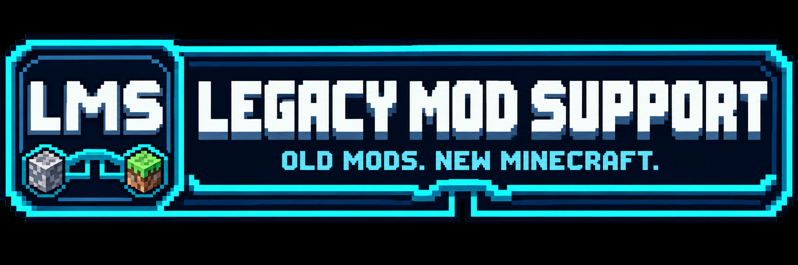

# LMS — Legacy Mod Support



Binary-first compatibility system for legacy Minecraft Forge/FML mods on modern NeoForge.

**Target:** Minecraft 26.3, NeoForge 26.3.0.58-beta, Java 25.  
**First legacy profile:** Forge 1.19.2.  
**Reference mod:** IC2 Classic 1.19.2.

## Repository structure

See [repository navigation](docs/repository-layout.md) for package ownership,
source profiles, target adapters, build scripts and local generated state.
The [API-family matrix](docs/compatibility-api-coverage.md) tracks current coverage
and the verification queue.

## Development

Use the repository Gradle wrapper (9.2.1).

```bash
./gradlew runClient
./gradlew runServer
./gradlew build
```

Put candidate legacy JARs in the **development run directory** under `legacy-mods/`.

LMS is under active compatibility development. Discovery, managed legacy loading, bytecode transformation and runtime adaptation exist, but compatibility is incomplete and subsystem support must be judged by verified compatibility milestones rather than by startup alone.

See `openspec/` for normative requirements, architecture and change proposals. In particular:

- `openspec/project.md` — product scope and normative goals;
- `openspec/specs/version-profiles/spec.md` — legacy source generations/profile families;
- `openspec/specs/compatibility-architecture/spec.md` — Source Profile -> semantic operations -> Target Adapter architecture;
- `openspec/specs/compatibility-runtime-vision/spec.md` — long-term Legacy Minecraft Mod Compatibility Runtime vision, including loader-neutral semantics and future Fabric/multi-generation possibilities;
- `openspec/specs/target-runtimes/spec.md` — maintaining LMS across future Minecraft/NeoForge targets;
- `openspec/specs/compatibility-verification/spec.md` — testing and compatibility evidence;
- `AGENTS.md` — mandatory repository rules for autonomous coding agents.

Runtime debugging uses the existing `minecraft` MCP server / MCP Fabric when
available. See [the runtime runbook](docs/runtime-debugging-mcp.md) for connection
and world gates, native Quick Play launch, structured content/behavior checks,
log collection and explicitly unsupported operations. The tool is development
instrumentation and does not add Fabric compatibility to LMS.
